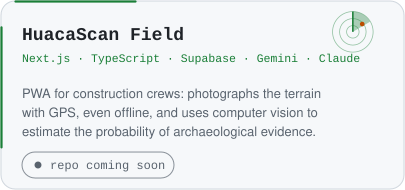
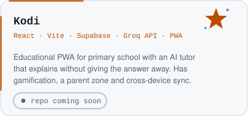
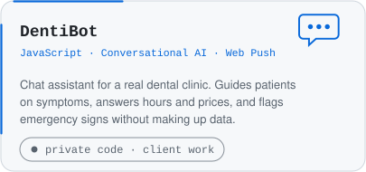
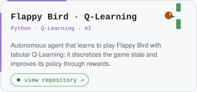

<a href="https://github.com/sebastian-yengle08/sebastian-yengle08/blob/main/README.en.md"><picture><source media="(prefers-color-scheme: dark)" srcset="assets/header-en-dark.svg"></picture></a>

<a href="https://github.com/sebastian-yengle08?tab=repositories"><picture><source media="(prefers-color-scheme: dark)" srcset="assets/now-en-dark.svg"></picture></a>

  <a href="https://github.com/sebastian-yengle08"><picture><source media="(prefers-color-scheme: dark)" srcset="assets/lang-es-off-dark.svg"></picture></a>
  &nbsp;
  <a href="https://github.com/sebastian-yengle08/sebastian-yengle08/blob/main/README.en.md"><picture><source media="(prefers-color-scheme: dark)" srcset="assets/lang-en-on-dark.svg"></picture></a>

<picture><source media="(prefers-color-scheme: dark)" srcset="assets/about-en-dark.svg"></picture>

 

<picture><source media="(prefers-color-scheme: dark)" srcset="assets/title-stack-en-dark.svg"></picture>

<picture><source media="(prefers-color-scheme: dark)" srcset="assets/stack-en-dark.svg"></picture>

 

<picture><source media="(prefers-color-scheme: dark)" srcset="assets/title-projects-en-dark.svg"></picture>

  <picture><source media="(prefers-color-scheme: dark)" srcset="assets/project-huacascan-en-dark.svg"></picture>
  <picture><source media="(prefers-color-scheme: dark)" srcset="assets/project-kodi-en-dark.svg"></picture>

  <picture><source media="(prefers-color-scheme: dark)" srcset="assets/project-dentibot-en-dark.svg"></picture>
  <a href="https://github.com/sebastian-yengle08/Flappy_Bird"><picture><source media="(prefers-color-scheme: dark)" srcset="assets/project-flappy-en-dark.svg"></picture></a>

Also on my GitHub: <a href="https://github.com/sebastian-yengle08/AWS-TerraformGrupo11">AWS-TerraformGrupo11</a> &nbsp;·&nbsp; <a href="https://github.com/sebastian-yengle08/labora-02-docker-compose">labora-02-docker-compose</a>

 

<picture><source media="(prefers-color-scheme: dark)" srcset="assets/title-leadership-en-dark.svg"></picture>

<picture><source media="(prefers-color-scheme: dark)" srcset="assets/leadership-en-dark.svg"></picture>

  <a href="https://www.linkedin.com/in/sebastian-y-716389274"><picture><source media="(prefers-color-scheme: dark)" srcset="assets/contact-linkedin-dark.svg"></picture></a>

<picture><source media="(prefers-color-scheme: dark)" srcset="assets/footer-en-dark.svg"></picture>
