<a href="https://github.com/sebastian-yengle08"><picture><source media="(prefers-color-scheme: dark)" srcset="assets/hero-es-dark.svg"></picture></a>

<a href="https://github.com/sebastian-yengle08?tab=repositories"><picture><source media="(prefers-color-scheme: dark)" srcset="assets/now-es-dark.svg"></picture></a>

<picture><source media="(prefers-color-scheme: dark)" srcset="assets/open-es-dark.svg"></picture>

  <a href="https://github.com/sebastian-yengle08"><picture><source media="(prefers-color-scheme: dark)" srcset="assets/lang-es-on-dark.svg"></picture></a>
  &nbsp;
  <a href="https://github.com/sebastian-yengle08/sebastian-yengle08/blob/main/README.en.md"><picture><source media="(prefers-color-scheme: dark)" srcset="assets/lang-en-off-dark.svg"></picture></a>

<picture><source media="(prefers-color-scheme: dark)" srcset="assets/about-es-dark.svg"></picture>

 

<picture><source media="(prefers-color-scheme: dark)" srcset="assets/sheet-es-dark.svg"></picture>

 

<picture><source media="(prefers-color-scheme: dark)" srcset="assets/title-stack-es-dark.svg"></picture>

<picture><source media="(prefers-color-scheme: dark)" srcset="assets/stack-es-dark.svg"></picture>

 

<picture><source media="(prefers-color-scheme: dark)" srcset="assets/title-projects-es-dark.svg"></picture>

<picture><source media="(prefers-color-scheme: dark)" srcset="assets/constellation-es-dark.svg">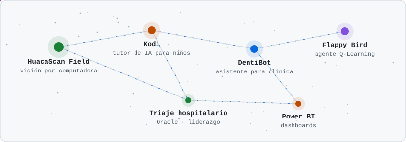</picture>

  <picture><source media="(prefers-color-scheme: dark)" srcset="assets/project-huacascan-es-dark.svg">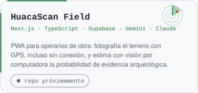</picture>
  <picture><source media="(prefers-color-scheme: dark)" srcset="assets/project-kodi-es-dark.svg">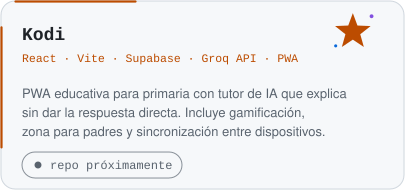</picture>

  <picture><source media="(prefers-color-scheme: dark)" srcset="assets/project-dentibot-es-dark.svg">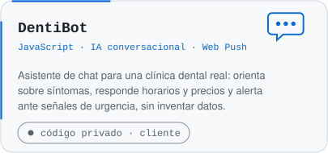</picture>
  <a href="https://github.com/sebastian-yengle08/Flappy_Bird"><picture><source media="(prefers-color-scheme: dark)" srcset="assets/project-flappy-es-dark.svg">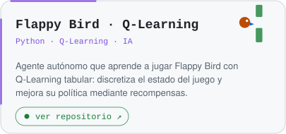</picture></a>

También en mi GitHub: <a href="https://github.com/sebastian-yengle08/AWS-TerraformGrupo11">AWS-TerraformGrupo11</a> &nbsp;·&nbsp; <a href="https://github.com/sebastian-yengle08/labora-02-docker-compose">labora-02-docker-compose</a>

 

<picture><source media="(prefers-color-scheme: dark)" srcset="assets/title-leadership-es-dark.svg"></picture>

<picture><source media="(prefers-color-scheme: dark)" srcset="assets/leadership-es-dark.svg"></picture>

  <a href="https://sebastian-yengle08.github.io"><picture><source media="(prefers-color-scheme: dark)" srcset="assets/contact-portfolio-dark.svg">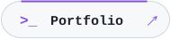</picture></a>
  &nbsp;
  <a href="https://www.linkedin.com/in/sebastian-y-716389274"><picture><source media="(prefers-color-scheme: dark)" srcset="assets/contact-linkedin-dark.svg"></picture></a>

<picture>
  <source media="(prefers-color-scheme: dark)" srcset="https://raw.githubusercontent.com/sebastian-yengle08/sebastian-yengle08/output/github-snake-dark.svg">
  
</picture>

<picture><source media="(prefers-color-scheme: dark)" srcset="assets/footer-es-dark.svg"></picture>
